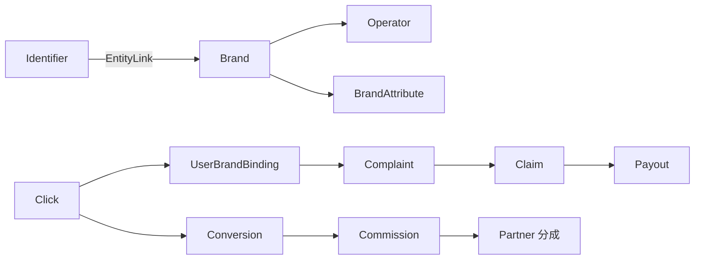
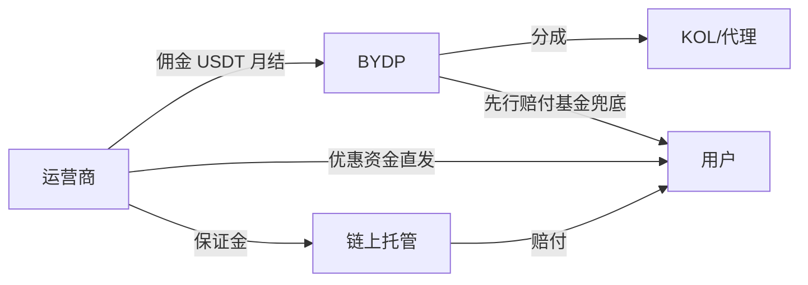
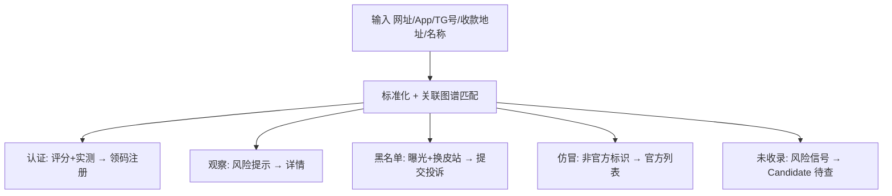
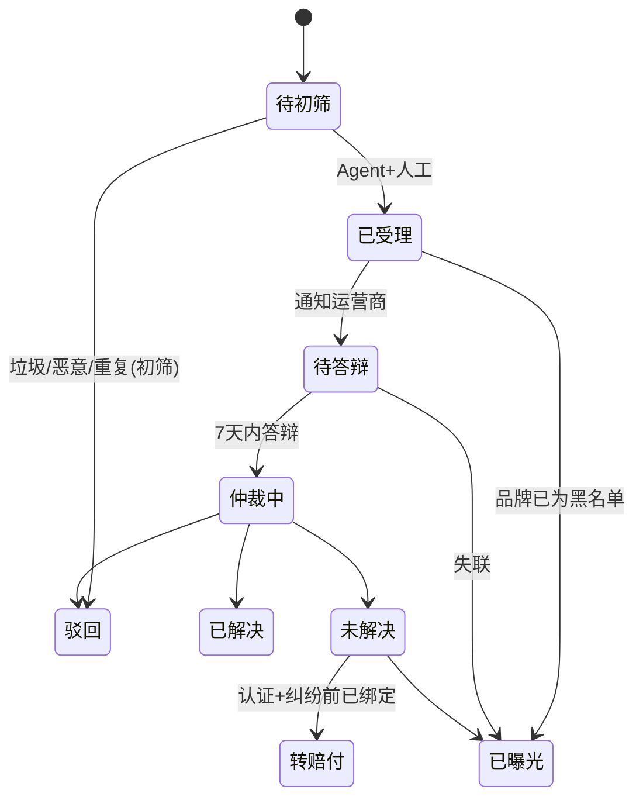

# BYDP「博弈点评」产品架构文档 v1.2

2026-09-23 · 本文件为架构基线（v1 在线版：https://claude.ai/code/artifact/5e16ecf1-1780-46d6-81c8-bcc389333974 ，v1.1 以本地文件为准）

> **v1.2 变更记录（2026-09-23，设计阶段回写，PO 通过）**
> **v1.19（2026-10-24，D-029 口径审定 · 审核兼协调 W2#019）** §8.1 优惠「真实价值」换算口径（参数表版本化、四类公式、多玩法取最高优势、免死金按概率逐项计、文案模板；其他类型首版不支持）。
> **v1.18（2026-10-10，D-024 方案裁定）** §5 S4 trustWeight 定义（按提交时绑定等级定死）；出款凭证 / 评价须审核后计分、凭证须附截图、评价文字 v1 不公开。
> **v1.17（2026-10-04，A-018 审核）** §9.2 跨表不变量触发器先锁父行 + 命名 CONSTRAINT 映射。
> **v1.16（2026-10-04，M3 验收 / D-020）** Offer 独立状态（A-018）；上线冲刺以 HANDOVER §9 为唯一真源。
> **v1.15（2026-10-03，D-018 审核）** 品牌状态变更收紧：认证 / 离开黑名单只限 admin、保证金非空、关联方永不认证（触发器待 A-018）。
> **v1.14（2026-10-03，D-018）** §9.2 品牌状态变更口径（后台人工 + 重新验证 + 黑名单连带 + 订阅通知）。
> **v1.13（2026-10-03，D-016 第 2 轮）** §13 ⑤ 去刷改按 IP 网段 + 首页热查门槛与中性措辞；⑥ 抓取开关默认关。
> **v1.12（2026-10-03，D-016）** §13 Agent 实现约束：只写 review_item、规则优先、LLM 默认关 + 去标识 + 预算、抓取礼貌、Candidate 去刷口径。
> **v1.11（2026-10-03，A-015 审核）** §9.2 匿名化补充：删后台角色 / 纪元 +1；排除期内与未结案拒绝注销；0013 `identity_block`、已结案案件删原文 + description 覆盖、device 180 天、互斥触发器 UPDATE 修正。
> **v1.10（2026-10-01，admin 第 2 轮）** §9.2 注销匿名化**执行口径**：owner 级 `bydp_anonymize_user()` 单事务——积分负分冲销事件归零、绑定 `revokedAt` 失效（哈希列不改，唯一约束改部分索引）、删 identity / 联系方式 / 偏好 / 订阅 / 通知、`app_user.anonymizedAt` + 昵称替换；只追加表的行与外键保留；self_exclusion 快照保留。迁移 A-015。
> **v1.9（2026-09-30，M2 收尾）** §9.2 数据请求处理口径（未结案案件只能脱敏不能删原文；注销执行前经登记联系方式确认；anonymize 申请二次验证在 core 统一校验）；M3 登记项：设备指纹 / tg-bot 交互 / 排除期公开页显示层门控。
> **v1.8（2026-09-30，迁移 0008 范围）** 用户域：UserBrandBinding.operatorAccountId 字段级加密（AES-256-GCM，AAD=binding.id，明文列删除，盲索引保留）· SelfExclusion（只追加）· UserPreference（限额提醒偏好）· DataRequest（脱敏 / 删原文 / 导出 / 注销匿名化申请）；core 拒绝绑定黑名单品牌（400）。
> **v1.7（2026-09-29）** §9.2 P1 答辩期人工通知 / 人工确认曝光；积分规则种子与等级门槛；通知至少一次 + M3 deliveredAt。
> **v1.6（2026-09-28，A-007 落地 K1/K2 + M2 投诉写路径）** 回传确认改 4 条件；P1 佣金只开 CPA，RevShare 待净收入回传格式确认；§9.2 增「待初筛 → 驳回」；证据哈希规范 v1 定死；投诉 title 自动生成可改。
> **v1.5（2026-09-27，A-007 tracking 缺口 G1–G4）** 商业域：Offer.redirectTemplate（官方主机校验）· OperatorIntegration · CommissionTerm · Conversion / Commission 只追加 · 归因末次点击 30 天 · 回传确认三条件。v1.4：Candidate.domainRegisteredAt；BrandCard 契约 primaryDomain / logoUrl / reviewCount。
> **v1.3（2026-09-26，M0 审核裁定回写）** §7 补：Brand.logoUrl；Identifier.primary（每品牌最多 1 条官方主域，部分唯一索引）；UserBrandBinding.operatorAccountIdHash（HMAC 盲索引，`(brandId, hash)` 唯一，写入后不可改）；Exposure 与 Complaint 的关联改为关联表 ExposureComplaint（删除 complaintIds / linkedBrandIds 数组，linkedBrandIds 由 EntityLink 推出）；治理域新增 UserRole 用户↔角色；User 物理表名 `app_user`；Complaint.eventDate / description 必填；scoring 只读授权 = 白名单（信任域 + 运营商域非商业表 + brand / withdrawal_report / complaint / review 列级），见 ADR-0006。
> §7 补（v1.2）：Complaint.title / eventDate；Candidate.riskSignals 结构化 {signal, severity, source}；SimResult.bustProbability / expectedValue；用户域新增 PointsRule（可配）与 User.level / points；治理域新增 OfficialChannel；Content.type 枚举含 advice（判定建议文案，key = verdict）。
> 设计基线：`docs/design/` 高保真 v1 已冻结，字段映射 `field-mapping.md`，接口 `api-contract.yaml`。

> **v1.1 变更记录（2026-09-23，依据第 0 步审计 + PO 裁定）**
> §2 大陆排除以公示声明为主、Web 层 IP 屏蔽为辅，TG 渠道不另做屏蔽（PO 裁定）；补隐私法约束。
> §5 补评分冷启动规则、排序隔离、出款因子 P1 数据源、关联方永不认证/永不结佣。
> §6 P1 补账号与身份、通知、RBAC 与审计、反滥用、运营商接入最小包。
> §7 Domain 泛化为 Identifier（含收款地址）；新增 Candidate、BrandAttribute、Identity/Device、Notification/Subscription、Role/AuditLog、AbuseFlag；Binding 加核验等级；证据哈希只追加、原文可删；定哈希算法。
> §8 保证金账目分离、赔付优先；托管模型原则；不经手资金的例外清单。
> §9 失联定义、跳过答辩条件、"纠纷前绑定"口径。
> §11 繁体单路径取台湾口径，港澳词进搜索同义词。
> §14 补隐私删除请求、托管商封禁应急、法律函流程。
> 新增 §16 技术选型（已确认）。

## 1. 项目概述与定位

BYDP 是面向全球华人的博彩信任基础设施：以黑盘识别和出款仲裁为核心，以联盟导流为变现，对标并融合 Casino.Guru 与 AskGamblers。

- **项目名 / 代号**：BYDP（暂定）
- **一句话定位**：帮你识别黑盘，协助追款曝光；在优选认证库的商家出事，我们先行赔付。
- **宗旨**：尽最大可能为博彩用户生态提供价值，为净化华人博彩市场贡献技术力量。
- **本质**：信任层 + 导流生意，不做运营、不做庄，原则上不经手用户资金（例外见 §8）。
- **质量原则**：质量从第一天按生产级做，范围按闭环分三期上线；架构按终局一次设计到位。

## 2. 市场范围与合规底线

首发东南亚华语区全域，中国大陆永久排除；欧美华语区后期考虑。

| 阶段 | 市场 | 说明 |
| --- | --- | --- |
| 首发 | 新加坡、马来西亚、菲律宾、泰国、越南、柬埔寨等东南亚华语区；港澳台 | 默认语言简体，繁体、英文同步 |
| 后期 | 北美、澳洲、欧洲华人 | 英文版承担更多角色 |
| 永久排除 | 中国大陆 | 面向大陆居民推广境外赌博存在刑事风险 |

合规底线（写入架构底层）：

- **大陆排除**：全站、TG Bot 与所有终端常驻公示"不向中国大陆居民提供服务"声明（简/繁/英）；Web 层做大陆 IP 屏蔽（边缘 WAF + 应用层读 `CF-IPCountry` 兜底），与语言逻辑解耦；不做面向大陆的内容与投放。TG 渠道依赖 Telegram 在大陆不可直接访问的事实过滤，不另做技术屏蔽（PO 裁定 2026-09-23）。
- 年龄确认、赞助 / 联盟关系披露、负责任博彩入口全站常驻。
- 独立运营主体与品牌，与关联运营商、游戏商隔离（见 §14）。
- **隐私**：首发市场适用新加坡 PDPA、马来西亚 PDPA、台湾个资法；用户可请求删除个人证据原文（见 §7 Evidence 规则）。

## 3. 核心理念与四大杀手锏

英文站的价值是"帮你选"，BYDP 的价值是"帮你避坑、出事帮你追、认证商家坑了你我们先赔"。

| 杀手锏 | 定义 | 关键设计 |
| --- | --- | --- |
| 1. 认证商家先行赔付 | 认证库商家违约、跑路，BYDP 先行赔付用户 | 资金主来源为运营商保证金（USDT），链上储备公示；平台先行赔付基金有上限兜底；对外称"先行赔付保障"，不称"保险"；保证金金额后期配置 |
| 2. 专属优惠码通道 | 认证 / 观察库运营商在 BYDP 独家发放奖励与优惠 | 优惠资金由运营商直发用户；非认证商家强制风险标签且不享赔付；黑名单永不接入；每个优惠换算"真实价值"（流水倍数、最高提款、限制游戏） |
| 3. 策略实验室 + 防沉迷中心 | 用数据让玩家认清赌博本质 | 蒙特卡洛模拟展示各流行打法的长期期望与爆仓概率；只宣传资金管理与止损，不宣传"稳定获利策略" |
| 4. 黑盘识别 + 仿冒识别 | 一键查询平台、域名、App、TG 号、收款地址 | 主体-品牌-标识三级拆分 + 关联图谱，抓换皮盘、跑路重开、假冒正规盘 |

## 4. 对标融合：Casino.Guru × AskGamblers

BYDP 取两家之长，再叠加华语市场特有的四个变量。

| 来源 | 采纳能力 | BYDP 落地 |
| --- | --- | --- |
| [Casino.Guru](https://casino.guru/) | 规模化结构化数据库；免费试玩与锦标赛；论坛自动翻译；RG 与公益形象；出站链接按坑位归因 | 数据层、社区锦标赛（P2）、防沉迷中心、联盟追踪 |
| [AskGamblers](https://www.askgamblers.com/) | 透明评分权重、每日重算；认证标准 + 持续监测；运营商代表后台；认证商家挂投诉入口与反向链接；体育扩展 | 评分引擎、认证体系、运营商后台、认证商家挂 BYDP 投诉入口 |
| 华语市场变量 | 黑盘 / 仿冒泛滥；USDT 与本地电子钱包为主；百家乐、真人、体育、彩票、捕鱼、棋牌权重高；Telegram 为主战场 | 黑盘查询、出款表现、支付与游戏维度重做、TG Bot / Mini App |

两家的护城河都是投诉数据库而非评测文章；BYDP 的护城河 = 投诉数据 + 关联图谱 + 保证金。

## 5. 信任体系

弱化持牌、以履约为准：每个品牌有一个互斥的信任状态，牌照只是标签；用户看到四个库。

| 用户可见的库 | 数据含义 | 规则 |
| --- | --- | --- |
| 平台认证名单 | 状态 = 认证 | 通过认证标准 + 缴纳保证金；享先行赔付；可发专属码 |
| 非认证名单 | 状态 = 观察 | 已收录、未认证；可发码但强制风险标签，不享赔付；**有已曝光案件的品牌在名单与品牌页强制显示"曝光中"警示** |
| 持牌名单 | 标签 = 持牌（筛选视图） | 牌照编号经监管公开名录核验；持牌不等于可信，持牌盘也可进黑名单 |
| 黑名单 | 状态 = 黑名单 | 证据链 + 答辩期后判定；永不接入商业合作；附关联换皮站 |

**三层状态口径**（互不混用）：Brand.status（认证 / 观察 / 黑名单）× Identifier.ownership（官方 / 仿冒 / 待查）× Complaint.status（见 §9.2）。"曝光"是案件状态，不是品牌状态。

评分引擎（华语版权重，初稿，上线前定稿）：

| 因子 | 权重 | 数据来源 |
| --- | --- | --- |
| 出款表现（到账时长、拒付率） | 30% | **P1：绑定用户提交的到账凭证为主数据源；官方真钱实测为抽检与争议复核**；仲裁案件 |
| 仲裁履约（解决率、响应时长） | 25% | 仲裁中心 |
| 平台硬指标（支付方式、限额、客服、游戏商） | 20% | BrandAttribute：Agent 采集 + 人工核验 |
| 玩家评价（可信权重加权） | 15% | 评论系统 |
| 经营稳定性（运营年限、域名稳定、关联风险） | 10% | 关联图谱、标识监控 |

评分规则：

- 算法版本化、规则公开、每日重算；评分引擎读不到任何佣金 / 付费数据（代码级 + 数据库权限级隔离，见 §16）。
- **冷启动规则**：每个因子设最小样本量门槛；不足门槛的因子不计入，权重按可用因子归一化并在页面标注"基于 N 项因子"；全部不足时显示"暂无评分"而非低分；评分卡显示置信度等级（低 / 中 / 高）。
- **排序与推荐同受隔离**：首页推荐、名单页、组合页的排序规则与评分同等版本化、公开；排序实现位于 `packages/scoring`；赞助位为物理独立组件、明确标注、不参与排序。
- 认证不收费、不可购买；门槛为评分阈值 + 仲裁履约阈值 + 实测 + 保证金。
- **评分算法 v0.3（2026-09-27 PO 定稿 = A-003 草案 + 审核 S1–S5；实现见 `packages/scoring/params.ts`，改公式须升版本并双签）**
  - 总分 = round(Σ wᵢ·sᵢ / Σ wᵢ)，仅对可用因子求和；权重 出款 30 / 仲裁 25 / 硬指标 20 / 玩家评价 15 / 稳定性 10。黑名单 score = null。置信度：可用因子 0 none · 1–2 low · 3–4 medium · 5 high。
  - **S5 严格口径**：履约类因子（出款 / 仲裁 / 评价）全部不足门槛 → score = null「暂无评分」，即便硬指标 / 稳定性可用（防新站仅凭自报属性得高分）。
  - 滚动窗口 180 天（出款 / 仲裁 / 评价）。
  - 门槛：出款 ≥ 20 条**绑定用户**凭证（fromBinding，S1）；仲裁 ≥ 5 件**已结案**案件；评价 Σ trustWeight ≥ 30（有效样本，S4）。**S4 trustWeight（v1.18）**：提交时按该用户在该品牌的绑定等级定死、之后不可改——运营商确认 / 回传确认级 = 1.0；自报级且绑定满 30 天 = 0.5；自报级不满 30 天 = 0.2；无绑定不可提交。只计 `review.status = published`、`withdrawal_report.status = accepted` 的行（D-024 / A-019）；硬指标 任一 brand_attribute；稳定性 收录 ≥ 30 天。
  - 子分：出款 = 60% 到账时长分（中位 ≤ 1h 100 · 24h 50 · ≥ 72h 0，分段对数插值）+ 40% × max(0, 1 − 拒付率 × 5) × 100，pending > 72h 计拒付（S3）；仲裁 = 70% 解决率 + 30% 响应分（中位 ≤ 1 天 100 · ≥ 7 天 0，未答辩按 7 天）；玩家评价 = (可信加权均星 − 1) / 4 × 100；硬指标 = 支付 / 游戏商 / 客服三维计数分均值（满分数 4 / 4 / 3），未核验维度 × 0.7；稳定性 = 年限分 50%（≥ 5 年满）+ 域名稳定 30%（无官方域名 50 分）+ 关联风险 20%（与黑名单关联只认人工确认、置信 ≥ 0.8、排除仿冒边）。
  - 排序归 scoring：score_desc（null 置后 → 置信度 → statusSince → slug）· listed_at_desc；推荐位仅 certified；赞助位不参与排序。
  - **v0.4（2026-09-27 落地，A-005，v0.3 的增量）**：出款门槛改为 ≥ 20 个**不同绑定**（只计已有结论的凭证）；每个绑定按 requestedAt 升序、30 天**滑动窗口**内最多计 3 条，限额在 180 天窗口 / 有效性 / 已有结论三道过滤之后执行，门槛、拒付率、到账中位数均只用限额后的集合；scoring_ro 增读 withdrawal_report.bindingId（迁移 0004）。v0.5 候选：自报级绑定降权或只计回传 / 运营商确认级。
  - **演示分数（2026-09-27 协调官按审核建议裁定）**：赢家体育 41 → **31**（公开中位到账 3.2 天 > 72h，时长分为 0，公式真实结果）；金龙「中位响应」1.8 → **4 天**（唯一为对齐 ±2 调整的已公开明细）；星辰彩票按 S5 为「暂无评分」。原型与文案已同步。demo 数据锚定 2026-09-23，演示环境每日评分保持关闭。
  - 演示数据：demo 标记的 mock 原始数据仅入演示库，生产 seed 不含 demo 行；页面分数一律由重算得出，不手填。
- **关联方**（创始人关联的运营商、游戏商）：可收录并披露，但**永不进入认证库、永不结算佣金**。
- 仲裁与曝光：证据标准公开，运营商享答辩期（建议 7 天），所有状态变更只追加、可审计。

## 6. 生产级全景架构与分期

三期上线，每期都是可商用的生产级闭环：P1 信任闭环、P2 双边闭环、P3 担保闭环。

| 子系统 | P1 信任闭环 | P2 双边闭环 | P3 担保闭环 |
| --- | --- | --- | --- |
| 用户端 | H5 / PWA 主站（简 / 繁 / 英）；TG Bot | TG Mini App；Android APK | — |
| 账号与身份 | TG 登录、邮箱 magic link；账号合并；设备指纹 | 运营商账号体系 | — |
| 信任引擎 | 运营商库（状态 × 标签）；评分（含冷启动规则）；黑盘 / 仿冒查询；仲裁与曝光；出款表现（用户凭证 + 抽检） | 认证体系 | 先行赔付；保证金链上公示 |
| 商业引擎 | 联盟追踪（坑位 / 渠道 / KOL）；优惠码通道 + 真实价值换算；**运营商接入最小包**（postback 规范 + 人工配置，回传须含运营商侧账号 ID） | 运营商后台（认领、发码、答辩）；赞助位；联盟投诉 | 保证金管理；风控数据 API |
| 内容引擎 | 评测、防骗专题、资讯；策略实验室；防沉迷中心 | 游戏库与试玩 | — |
| 社区 | 玩家评分与评论 | 积分等级；论坛、晒单；免费锦标赛 | — |
| 通知 | 状态变更订阅、投诉进度（TG 推送、邮件） | Mini App 内推送 | 赔付进度 |
| 反滥用 | 查询 / 评论 / 投诉限流；待查队列加权去刷；评论可信权重 | 运营商侧刷量识别 | 赔付多账号风控 |
| Agent 系统 | 采集、站点监控、三语本地化、投诉初筛、内容生成 | 扩展到运营商对接与数据核验 | 赔付风控辅助 |
| 运营后台 | 审核台、仲裁台、风控、CMS、数据看板；**RBAC（仲裁 / 商务 / 编辑 / 管理员角色隔离）+ 操作审计日志** | 运营商与 KOL 管理 | 赔付审批台 |
| 基础设施 | 大陆屏蔽与声明；高防 + CDN；域名矩阵；官方渠道验证页 | — | 链上托管与公示 |

- P1 必须提前埋好 P3 所需数据：用户-品牌绑定（含核验等级与服务端时间戳）、证据哈希存档（SHA-256）、运营商履约记录。
- P1 核心指标：查询量、投诉受理量、绑定率、首存转化。

## 7. 数据模型

七个域、三条关系链；主体-品牌-标识三级拆分是黑盘识别的根基，也是超越两家英文站的技术点。**本节是交互设计阶段的硬约束：设计稿上每个信任信号必须能映射到本节某个实体字段。**

| 域 | 实体 | 要点 |
| --- | --- | --- |
| 运营商 | Operator 主体（relatedParty 挂此，品牌继承，ADR-0003）· Brand 品牌（logoUrl）· **Identifier 标识**（primary 官方主域，每品牌 ≤ 1；type: domain / mirror / app / tg / wallet 收款地址 / phone；ownership: 官方 / 仿冒 / 待查）· EntityLink 关联图谱 · License 牌照 · **BrandAttribute 品牌属性**（维度字典：支付方式、游戏商、目标市场、语言、限额、客服渠道；值 + 采集来源 + 核验状态）· **Candidate 待查目标**（未收录的查询对象，含查询频次与去刷后的优先级；riskSignals[] 结构化为 {signal, severity, source}，标注待人工确认；**v1.4 增 domainRegisteredAt（WHOIS 注册日，Agent 采集，可空）**） | 一主体多品牌、一品牌多标识；关联边带置信度且可跨标识类型；组合列表页与硬指标因子由 BrandAttribute 驱动 |
| 信任 | StatusHistory 状态变更 · ScoreSnapshot 评分快照（算法版本、因子可用数、置信度）· WithdrawalReport 出款报告（用户提交 / 官方实测两类）· Complaint 案件（title, category, amountUsdt, **eventDate**, description, publicSummary, replyDeadline）· Evidence 证据 · OperatorReply 答辩 · Exposure 曝光 · **ExposureComplaint 曝光-案件关联**（外键，替代数组） | 状态日志与**证据哈希**只追加；**证据原文可脱敏或按隐私请求删除，哈希与状态日志不受影响**；哈希 = SHA-256（文件 + 规范化元数据），P3 上链锚定；评分带算法版本 |
| 商业 | Offer 优惠（**redirectTemplate** 联盟跳转模板，品牌级兜底）· PromoCode 专属码 · Click 点击 · Conversion 转化（**只追加**；`(brandId, externalEventId)` 唯一；更正只写冲正事件）· Commission 佣金（**只追加账本**，记 termId）· **CommissionTerm 佣金条款**（品牌 · 合作方可空 · 模式 CPA / RevShare · 金额 / 比例 · 生效起止，排除约束保证同品牌同合作方区间不重叠）· **OperatorIntegration 运营商对接**（postback 端点、HMAC 密钥**引用名**——密钥本体在 KMS / 环境变量、时间窗、状态）· Partner KOL/代理 · AffiliateComplaint 联盟投诉 | Offer 存真实价值换算值；Click 带坑位、渠道、地区、KOL；**跳转模板目标主机必须属于该品牌 ownership=official 的标识，保存时校验，占位符只允许 `{clickId}`**；回传 HMAC 签名覆盖报文 + 时间戳，只接受 5 分钟内；**归因 = 末次点击 + 30 天窗口**，无 clickId 时按 operatorAccountIdHash 匹配绑定；绑定升级「回传确认」须同时满足 **4 条件**：签名通过 + 哈希匹配 + 绑定时间早于回传时间 + **该转化归因到的 Click.userId = 绑定的 userId**（账号归属证明；无 clickId 的哈希兜底回传只记转化不升级，v1.6 K1）；黑名单与关联方在 tracking 层硬拦永不结佣（ADR-0003）；0005 新表对 scoring_ro 一律不授权（v1.5，2026-09-27，A-007 G1–G4） |
| 用户 | User（level, points）· **PointsRule 积分规则**（可配置：绑定 / 出款凭证 / 评论等事件→分值，P1 上线）· **Identity 登录身份**（TG / 邮箱，多身份合并）· **Device 设备指纹** · UserBrandBinding 用户-品牌绑定（operatorAccountIdHash 盲索引，(brandId, hash) 唯一；**operatorAccountIdEnc 密文，无明文列，v1.8**；仅认证 / 观察库品牌可绑，黑名单 core 层拒绝）· Review 评论 · **Subscription 订阅** · **Notification 通知** · **SelfExclusion 自我排除**（只追加：userId · period 30/90/180/365/permanent · startsAt · endsAt 可空=永久 · identityHashes 快照；**生效 = 任一条未到期，取最晚 endsAt**（较短档位不能缩短）；permanent 用户不得再新增登录身份（D1）；期内隐藏优惠 / 领码 / 前往官网，permanent 同时拒绝该身份哈希再注册）· **UserPreference 偏好**（userId PK · dailyDepositAlertUsdt · sessionAlertMinutes · nightAlert bool；仅提醒）· **DataRequest 数据请求**（id · userId · kind redact_evidence/delete_evidence/export/anonymize · targetIds jsonb · status pending/done/rejected · note · createdAt · resolvedAt；状态变更写 audit_log） | 绑定 = 运营商侧账号 ID + 注册来源 + **服务端时间戳（不可改）** + **verification_level（自报 / 回传确认 / 运营商确认）**；赔付资格只认后两级 |
| 担保（P3） | Deposit 保证金 · Claim 赔付申请 · Payout 赔付 | Claim 必须关联 Complaint + Binding；Payout 存链上交易哈希；Deposit 分"用户赔付准备金"与"超额部分"两账目 |
| 内容 | Content 多语言内容（type ∈ guide / lab / news / advice；advice 以 verdict 为 key）· Glossary 术语表 · SimResult 策略模拟结果（bustProbability, expectedValue, runs） | 简体为源，繁 / 英为译本 |
| 后台与治理 | **Role 角色 · **UserRole 用户↔角色** · AuditLog 操作审计 · AbuseFlag 滥用标记 · RateLimitRule 限流规则 · OfficialChannel 官方渠道**（域名 / TG / Bot，供官方验证页与仿冒比对） | 仲裁角色与商务角色物理隔离；所有后台写操作入 AuditLog |

三条链依次为：黑盘识别链、担保追溯链、变现归因链。

## 8. 商业闭环

联盟佣金是主收入，认证不收费；平台原则上不经手用户资金。

| 收入 | 付费方 | 期 | 规则 |
| --- | --- | --- | --- |
| 联盟佣金（主收入） | 认证 / 观察库运营商 | P1 | **P1 只结 CPA**（首充触发、同账号只结一次、注册不结、未归因不结、以服务端接收时间为归因基准）；**RevShare 按净游戏收入（非充值额）月结，待首家运营商确认净收入回传格式后单独提审启用**，P1 遇 revshare 条款记录跳过原因不产生佣金；合作方停用后其历史点击带来的转化不再结佣（记跳过原因）；已付款佣金遇冲正只追加 void，追回走 M3 后台；黑名单不结算；关联方不结算 |
| 优惠码通道 | 运营商 | P1 | 转化产生佣金；独家位可付费但必须标注"赞助" |
| 赞助展示位 | 运营商、游戏商 | P2 | 明确标注，不影响评分与排序 |
| 风控数据 API（B2B） | 支付商、游戏商、正规运营商 | P3 | 黑盘库与实时查询 |
| 认证 | — | — | 不收费、不可购买 |

资金流：

**"不经手用户资金"的例外清单**（仅此两项）：① 先行赔付基金兜底（平台自有资金，单人 / 单案封顶）；② 链上托管的赔付触发。

**托管模型原则**（P3 前以 ADR-0001 定稿）：BYDP 不得单方控制托管资金；采用多签（运营商 + BYDP + 独立第三方）或按仲裁裁定哈希自动执行的合约；首发市场支付 / 托管牌照适用性在 P3 前完成法律核查。

**保证金账目分离**：保证金分"用户赔付准备金"与"超额部分"两账目；用户赔付绝对优先；佣金担保只可动用超额部分；运营商同时欠佣欠赔时先赔用户。

增长飞轮：黑盘查询 + 防骗内容引流 → 注册与绑定 → 投诉与曝光积累数据 → 公信力与搜索排名上升 → 运营商求认证、缴保证金、给独家优惠 → 独家优惠 + 赔付保障提升注册意愿 → 佣金增加 → KOL / 代理分销放大流量。

商业护栏：

- 观察库运营商优先谈 CPA 预付；认证库佣金由保证金超额部分担保；设"联盟投诉"记录运营商对 BYDP 的履约。
- 代理只能推广观察库及以上品牌，推黑名单即清退并扣佣；专属链接统一由平台生成。

### 8.1 优惠「真实价值」换算（v1.19 · D-029）
**原则**：真实价值 = 玩家按条款打满流水后的期望净值（USDT），宁可低估、不可夸大；导入 / 录入时由系统按本节公式计算，**不接受手填**；每条优惠的 `trueValue` 记录所用参数表版本 `methodVersion`（首版 `tv-1`），参数变更即升版本并全量重算。

**参数表 tv-1**（core 常量，随版本走）：
| 参数 | 值 |
|---|---|
| 庄家优势 e：老虎机 / 捕鱼 | 4%（RTP 96%） |
| 庄家优势 e：体育 | 5% |
| 庄家优势 e：真人（百家乐等） | 1.2%（取闲 / 庄注较高一侧，保守） |
| 适用游戏多类 | 取其中**最高** e（保守，不夸大价值） |
| 流水贡献率 c | `terms.contributionPercent`，缺省 100%；有效流水 T_eff = T ÷ c |
| 示例存款 D（匹配类） | 200 USDT，夹在 [最低存款, 最高奖励 ÷ 匹配比例] |
| 示例首注 D（免死金） | = 最高奖励 |
| 示例周流水 W（返水） | 1000 USDT |
| 免死金首注输的概率 p | 0.5 |
| 取整 | 四舍五入到整数 USDT |

**公式**：
1. 首存 / 再存匹配：B = min(D × 匹配比例, 最高奖励)；T = 流水倍数 × 基数（存款+奖励 → D+B；奖励 → B；存款 → D）；C = T_eff × e；N = B − C。最高提款不计入期望，B + D 超过时文案追加「上限 X USDT」。
2. 免死金：N = p × (B − T_eff × e) − D × e。
3. 周返水：B = W × `terms.rebatePercent`；无流水要求时 N = B，有流水要求按第 1 类扣成本。
4. 其他类型（无存款奖金 / 免费旋转等）：首版**不支持**，导入报「类型不支持」，另行定口径。

**结论与文案**：N > 0 → positive，否则 negative。模板——匹配类：「按 {RTP}% RTP {玩法} 打满流水，期望净值约 {±N} USDT；」+（N < 0）「奖励实为流水补贴，不是净收益」/（N > 0）「扣除流水成本后仍为正」；免死金：「首单输掉返还 {B} USDT 奖励金，{k} 倍流水后期望净值约 {±N} USDT；上限 {最高提款} USDT」；返水（无流水）：「无流水要求，按周结算，返水即净收益」。不得出现「保险」「留存率」。

## 9. 核心用户流程

四条主线：查询免登录引流；投诉、领码、赔付强制登录（支持 TG 一键登录），天然产生绑定数据。

**9.1 黑盘查询（免登录）**

结果页可订阅状态变更（TG 推送）；未收录标识进入 Candidate，查询频次经限流与去刷后提升待查优先级。

**9.2 投诉仲裁（登录，不强制绑定）**

- **失联**定义：答辩期内经官方联系渠道（认领时登记的邮箱 / TG）两次通知无响应。
- 跳过答辩直接曝光仅适用于品牌已为黑名单的案件。
- **P1 答辩期口径（v1.7，2026-09-29）**：P1 库中无运营商联系方式（运营商后台属 P2），故「两次通知运营商」由仲裁员经官方渠道**人工发出**并在仲裁台点「已通知」记录（写 audit_log：操作人 + 服务器时间）；定时任务只做提醒（答辩期剩 72h 提醒二次通知；期满标「待决定失联曝光」），**不自动曝光**，转曝光须仲裁员人工确认（写 audit_log）。测试以脚本代替人工点击。
- **积分（v1.7）**：P1 上线（HANDOVER #16），规则表 `points_rule` 种子：`binding_confirmed +500`（回传确认级及以上，每品牌一次）· `withdrawal_report_accepted +50`（凭证被采纳）· `review_published +20` · `complaint_resolved +100`；等级门槛 Lv1 0 / Lv2 500 / Lv3 1500 / Lv4 3000 / Lv5 6000；积分只从规则生效日起累计，**不追溯**；发放记入只追加 `points_event`（迁移 0007，双签），User.points 为派生缓存。动态流「+N 分」读 points_event；「已用」= 该码对应 Click 已有 first_deposit 转化。
- **通知（v1.7）**：站内通知 + TG/邮件推送为「至少一次」语义；`notification.deliveredAt / channel` 与漏推补扫任务放 M3（迁移与 0007 合并）。
- **注销 = 匿名化（v1.7，A-010 附带提示）**：points_event / conversion / commission 等只追加表外键指向 app_user，物理删除不可行；注销流程清除身份与联系方式（identity 行删除或置空密文）、绑定哈希与积分归零、动态断开归属，公开案件摘要 / 状态日志 / 证据哈希 / 佣金账本保留且不再关联；同一 TG / 邮箱可重新注册为新用户。M3 实现，需二次验证与 audit_log。
- **匿名化执行口径（v1.10，裁定 W3#047 三项）**：实现为 **owner 级 `SECURITY DEFINER` 函数 `bydp_anonymize_user(user_id, request_id)`**，单事务，由 `/admin/v1/data-requests/{id}/resolve done`（kind=anonymize，已联系确认）调用；函数内部对守卫的例外只在该函数体内生效，bydp_app 无直接权限。
  1. **积分**：写一条 `points_event`（`kind=anonymize_reversal`，`delta = -当前余额`，dedupeKey = request_id），由现有积分触发器把 `points` 归零、`level` 回 Lv1——不直接改 app_user 列，不违背只追加。规则表不需要新行（冲销不是规则事件）。
  2. **绑定**：不改哈希 / 密文 / 掩码列；新增 `user_brand_binding.revokedAt`（写一次），`(brandId, operatorAccountIdHash)` 唯一约束改为部分唯一 `where revokedAt is null`，这样同一真实账号可随新用户重新绑定；赔付资格、归因查询一律排除已失效绑定。
  3. **断开归属 = 保留行、保留外键、抹掉可识别信息**：click / conversion / commission / points_event / status_history / complaint 原样保留且外键不动；删除 identity 行、清联系方式、删 user_preference / subscription / notification；`app_user.anonymizedAt = now()`、`displayName = '已注销用户'`、头像置空；前台凡展示用户的地方按 anonymizedAt 隐藏。**self_exclusion 行与 identityHashes 快照保留**（永久排除不因注销失效）；data_request 行保留；写 audit_log（actor、request_id，不含被清除内容）。
  4. A-015 落地前，anonymize 的 `resolve done` 返回 409 `invalid_argument`「待迁移 A-015」，admin 前端禁用该按钮；其余三类数据请求照常。
  5. **补充（v1.11，A-015 审核）**：匿名化同时删除后台角色、会话纪元 +1；**有生效中的自我排除（含临时档）或未结案案件时拒绝执行**（409 `self_excluded` / `open_complaints`，core 层，0013 前过渡）。**0013（A-016）**：新建只追加表 `identity_block(identityHash, blockedUntil null=永久)`，注销函数把本人身份哈希 + 生效中排除的 endsAt 写入，`identity_permanent_block` 同时检查该表（临时排除期内注销不能绕过）；**已结案案件**：注销时删除证据原文（哈希保留）、`description` 用 publicDescription 覆盖、无则置「（已注销）」（description 守卫为函数开例外）；**未结案案件**先由仲裁员结案或判定撤诉再注销；device 行保留用于风控，注销 180 天后删除；互斥触发器 UPDATE 场景排除本行。
- **数据请求处理口径（v1.9，审核 M2 复核）**：`anonymize` 申请须二次验证——**core `createDataRequest` 统一校验 authTime ≤ 10 分钟**，web 与 Bearer 两入口共用，不在接口层各自判断；同一用户同 kind 仅一条 pending（0009 加部分唯一索引 `(userId, kind) where status='pending'`）；申请落库与站内确认通知同一事务。M3 执行时：**未结案案件的证据只能脱敏、不能删除原文**（删原文视同撤诉，须先告知投诉人并写 audit_log）；执行注销前经登记联系方式向本人确认一次。
- **跨表不变量触发器必须先锁父行（v1.17，A-018 审核）**：凡触发器依赖另一张表的状态（关联方 → 不可认证、黑名单 → Offer 不可 active），须先对父行**无条件** `FOR SHARE` 再检查，否则 READ COMMITTED 下并发可绕过；RAISE 带命名 CONSTRAINT，api 层按 `err.constraint` 精确映射错误码，不按通用 check_violation 映射。
- **迁移不得改只追加表（v1.9，A-013）**：conversion / commission / click / points_event 等只追加表，迁移也不得临时停用守卫改存量；需要新约束时用 `NOT VALID`。postback `raw` 只保存 PostbackBody 规范字段（白名单）且去掉账号字段。
- **品牌状态变更（v1.14，D-018；v1.15 收紧）**：后台操作，10 分钟重新验证，reason 必填，audit before/after；**转入「平台认证」与「离开黑名单」只限 admin**，且转认证要求 `certifiedDepositUsdt` 非空；转入黑名单、观察与其他状态互切 arbitrator 可操作；**关联方品牌永不认证**（core 409 `related_party` + 下次迁移加触发器兜底，owner 也拦）；Offer 独立 `status`（active / offline，A-018 口径更新：黑名单连带置 offline，解黑不自动恢复，由 admin 逐个恢复——因搜索与列表多处消费 Offer，隐式过滤易漏）；转黑名单同事务连带：有效 Offer 下线、评分 null、拒绝新增绑定；通知订阅者与该品牌进行中案件的投诉人（`brand_status_changed`，中性文案）。Agent 只能提议，不得改状态。
- **仲裁员身份校验（v1.7）**：M3 仲裁台接 core 三个答辩期动作前，api 层按 `user_role` 校验 arbitrator 角色（DB 枚举 arbitrator / commerce / editor / admin；文中 arbiter = arbitrator、bizdev = commerce），core 不信任调用方传入的 role。
- **案件公开文本（v1.9，admin 契约 Q1）**：`complaint.publicDescription`（A-014）为唯一公开陈述，仲裁员公开前逐项确认脱敏清单后写入；公开页与公开 API 不得读 `description` 原文。证据脱敏替换后原 sha256 保留、另存 redactedSha256。Agent 输出入 `review_item` 表待人工确认。
- 初筛驳回（v1.6）：仅限垃圾、恶意、重复或非本站受理范围；须填驳回原因并通知投诉人，不公开、不通知运营商；投诉人可补证据后重新提交（新案件）。
- 投诉标题：提交接口不要求 title，服务端按「类型 + 金额」自动生成（如「提款被拒 1,200 USDT」），受理时审核台可改；契约 ComplaintCreate.title 为可选覆盖。
- **证据哈希规范 v1（P1 定死，P3 上链锚定，不可再改）**：`sha256(文件字节 ‖ 0x00 ‖ 规范化 JSON{v:1, complaintId, type, size, txHash?})`，标签文字不参与；规范化 JSON = 键按字典序、无空白、UTF-8；**`txHash` 键始终存在，无值时写 `null`**（不省略键；2026-09-28 定稿，与当前实现一致）。

**9.3 领码注册（登录）**：浏览真实价值卡 → 领码 → 经跟踪链接跳转注册 → 回填运营商账号 ID 完成绑定（自报级）→ 注册 / 首存回传归因，回传含账号 ID 时绑定升级为回传确认级（奖励：积分 + 解锁赔付保障资格）。

**9.4 先行赔付（P3）**：触发条件 = 认证品牌 + **纠纷前已绑定**（绑定服务端时间 + 冷却期 N 天 早于纠纷事件时间，且 verification_level ≥ 回传确认）+ 仲裁裁定违约 + 限期未履行 → 风控（多账号、设备关联、条款核查）→ 保证金扣付 → 链上转账并公示哈希 → 运营商限期补足，否则降入黑名单。

## 10. 信息架构与 SEO 页面结构

H5 底部 5 个 Tab：首页、查黑盘、优惠、投诉、我的；SEO 页面由结构化数据程序化生成。

- **首页**：查询框置顶、今日黑盘预警、认证推荐、最新结案、内容流（评测 / 防骗 / 策略实验室）。
- **我的**：绑定的平台、我的投诉、领过的码、积分等级、订阅提醒、官方渠道验证。

| 页面类型 | URL | 搜索意图 |
| --- | --- | --- |
| 品牌页（含子页） | `/brand/{slug}`，`/complaints` `/withdrawal` `/domains` `/bonus` | XX 靠谱吗 / 官网 / 能出款吗 |
| 案件页 | `/case/{id}` | XX 不出款、冻结账号 |
| 曝光页 | `/exposed/{slug}` | XX 黑网、跑路 |
| 查询结果页 | `/check/{identifier}` | xx.com 是黑网吗 |
| 名单页 | `/certified` `/watchlist` `/licensed` `/blacklist` | 正规平台推荐、黑网名单 |
| 组合列表页 | `/list/usdt-baccarat-malaysia` | 马来西亚 USDT 百家乐平台（由 BrandAttribute 驱动） |
| 优惠页 | `/bonus/{id}` | XX 优惠码、首存 |
| 内容页 | `/guide/` `/lab/{strategy}` `/safe-play/` `/news/` | 百家乐打法、马丁策略 |
| 信任页 | `/methodology` `/certification` `/official` `/disclosure` `/regions` | 信任与 E-E-A-T；`/regions` 为服务地区与大陆排除声明 |

SEO 三条纪律：

- 组合页只生成匹配品牌数 ≥ 5 的组合，防薄内容降权。
- 查询结果页仅已收录实体可索引，未收录设 noindex。
- 不按 IP 自动跳语言，用横幅提示切换；大陆屏蔽与语言逻辑解耦。

## 11. 多语言规范

简体为默认语言与源文，繁体、英文为译本；繁简不做纯转码，靠术语表本地化。

| 语言 | 路径 | hreflang | 说明 |
| --- | --- | --- | --- |
| 简体中文 | `/` | zh-Hans | 默认语言、内容源文 |
| 繁体中文 | `/zh-hant/` | zh-Hant | **单一路径，页面用词取台湾口径；港澳口径词汇作为搜索同义词进 Meilisearch 索引，不单独成路径**（PO 可在 P2 前改为双路径） |
| 英文 | `/en/` | en | 服务海外华二代与运营商 B2B 门面 |

| 简体 | 台湾繁体（页面用词） | 港澳繁体（搜索同义词） | 英文 |
| --- | --- | --- | --- |
| 线上赌场 / 娱乐城 | 娛樂城 | 網上賭場 | Online casino |
| 老虎机 | 拉霸 / 老虎機 | 角子機 | Slots |
| 提款 / 出款 | 出金 / 提款 | 提款 | Withdrawal |

以上为术语表示例，完整术语表由 Agent 起草、人工审定后入库（Glossary 实体；代码可消费的真源为 `packages/i18n/glossary/`）。

## 12. 终端与渠道

移动端优先，PC 仅做响应式兼容；应用商店对博彩导流类 App 审核严格，iOS 原生暂不做。

| 优先级 | 终端 | 期 | 作用 |
| --- | --- | --- | --- |
| 1 | H5 / PWA 主站 | P1 | 主阵地，可添加到主屏 |
| 2 | TG Bot | P1 | 黑盘查询、领码、投诉进度、状态提醒 |
| 3 | TG Mini App | P2 | 完整体验内嵌 Telegram |
| 4 | Android APK（自分发） | P2 | 补充 |
| — | iOS 原生 App | 暂不做 | 上架风险高，iOS 用户走 PWA |

获客渠道：Google 自然搜索（案件页、查询页长尾）、Telegram 群与频道、YouTube、KOL / 代理分销。百度、微信不适用。

## 13. AI Agent 执行边界

能交给 Agent 的全部交给 Agent；涉及裁决、资金、真钱与商务的环节必须由人执行。

| Agent 执行 | 人工执行 |
| --- | --- |
| 运营商、优惠、游戏、条款数据采集 | 仲裁裁决与赔付审批 |
| 站点监控：宕机、换域名、条款偷改 | 黑名单最终判定 |
| 关联图谱线索发现（待人工确认） | 运营商商务谈判 |
| 评测初稿、防骗内容、SEO 页面生成 | 真钱出款抽检（KYC、出入金；账号主体与资金来源按运营手册） |
| 简 / 繁 / 英本地化 | 术语表与评分规则定稿 |
| 投诉初筛、证据整理、重复与恶意识别 | 对外声明与法律回应 |

最小人工编制：仲裁与风控 2 人、商务 1 人、主编 / 合规 1 人。

**Agent 实现约束（v1.12，D-016）**：① 所有 Agent 输出只写 `review_item`（kind + subject + source + proposal），approve 后由 core 按 kind 执行落地并写 audit_log（applied=true）；Agent 进程只持 bydp_app 之下的只读 + review_item 写权限。② 规则 / 确定性优先：采集与站点监控用 HTTP 抓取 + 结构化解析；本地化简↔繁用 OpenCC + 术语表；投诉初筛基线为规则（重复提交、同设备、金额 / 日期缺失、品牌不存在、黑名单命中）。③ LLM 仅在 `AGENT_LLM_ENABLED=1` 时启用，默认关；只在 worker 内调用；密钥仅 `.env.local`；每日 token 预算上限与超限告警；送入 LLM 前先去标识（手机 / 邮箱 / 账号正则脱敏），输出只作建议字段进 review_item；提示词版本化入库（`packages/agents/prompts/`），proposal 记录 model + promptVersion。④ 抓取遵守 robots 与频率上限（同主机 ≥ 10s 间隔），UA 标明 BYDP；站点监控仅 HEAD/GET 首页与条款页，不登录。⑤ Candidate 去刷（v1.13 定稿）：按 **IP 网段**（v4 /24、v6 /48，HKDF 派生密钥的 HMAC，不存原值）24h 内对同一标识只计 1 次，加权 = distinct 网段数，每日衰减重算；爬虫 / 预览 / 预取不计；真实 IP 须取自 Cloudflare 回源头（#2 / #4）。**首页「近期被查询较多」门槛**：有风险信号，或 ≥ 5 个不同网段查询过；措辞保持中性，不暗示黑盘。⑥ 站点监控与采集抓取由 `AGENT_CRAWL_ENABLED=1` 开启，默认关；演示 / 虚构品牌数据下不得开启，首批真实品牌入库后由 PO 决定（上线前置 #25）。

## 14. 风险与盲点清单

| 风险 | 化解设计 |
| --- | --- |
| 利益冲突（创始人关联持牌平台与游戏工作室） | 独立主体与品牌；关联方披露且永不认证、永不结佣；评分规则公开、人工仲裁独立执行 |
| 担保赔付被薅或规模失控 | 保证金为主、兜底基金封顶；单人 / 单案上限；纠纷前绑定（含冷却期与核验等级）为前提；多账号与设备风控 |
| 曝光引发诽谤诉讼 | 公开证据标准；运营商答辩期；状态与证据哈希只追加可审计 |
| 黑盘报复（仿冒站、DDoS、冒充客服） | 高防 + CDN；域名矩阵；官方标识与官方 TG 验证页 |
| 运营商赖佣、砍量 | 观察库优先 CPA 预付；认证库佣金由保证金超额部分担保；联盟投诉模块 |
| KOL / 代理推黑盘或冒用品牌 | 推广范围限观察库及以上；违规清退扣佣；专属链接平台统一生成 |
| 内容被指变相诱赌 | 不宣传"稳定获利策略"；策略实验室展示真实期望；防沉迷中心常驻 |
| SEO 降权 | 组合页门槛、未收录查询页 noindex、不做 IP 语言跳转 |
| 隐私 / 删除请求 | 证据原文可脱敏删除，哈希与状态日志保留；删除请求流程与 SLA 写入运营手册 |
| 托管商 / CDN 封禁 | 至少两家可切换的托管商；Docker Compose / IaC 可迁移；Postgres 异地备份至 R2 |
| 运营商法律函 / 删帖要求 | 标准应对流程：核对证据标准 → 答辩期补救 → 法律回应模板；只增补答辩、不删除记录 |
| 后台被攻破 | admin 不暴露公网（Cloudflare Access + 2FA）；敏感字段加密；RBAC + AuditLog |

## 15. 待定事项

以下事项不阻塞架构定稿，在进入对应阶段前确定。

- [ ] 正式平台名称与主域名（当前代号 BYDP）
- [ ] 运营主体注册地
- [ ] 保证金金额与梯度（P3 前）
- [ ] 先行赔付基金上限、单人 / 单案赔付上限、绑定冷却期 N（P3 前）
- [ ] 托管模型定稿与首发市场支付 / 托管牌照法律核查（P3 前，ADR-0001）
- [x] 评分权重定稿与各因子最小样本量门槛 → §5 v0.3（2026-09-27）；剩余：A-005 不同绑定去重（M2 前）
- [ ] 认证标准细则（P2 前）
- [ ] 繁体是否拆双路径（P2 前）
- [x] 技术栈（已确认，见 §16）

## 16. 技术选型（已确认 2026-09-23）

BYDP 是 SEO 驱动的 B2C 数据 / 内容平台，独立选型，与 NFGG、pachi-forge 无关。

| 层 | 选型 | 理由 / 取舍 |
| --- | --- | --- |
| 语言 / 仓库 | TypeScript 全栈；pnpm + Turborepo monorepo | 全栈同一语言，AI 编码支持最好 |
| 前台 H5/PWA | Next.js（SSR/ISR）；多实例时配置 Redis cache handler | 程序化 SEO 页、hreflang、移动优先；默认文件缓存多实例不共享 |
| 运营后台 | Next.js 独立 app，Cloudflare Access + 2FA，不暴露公网 | 与前台隔离部署 |
| 对外 API | Hono + `@hono/zod-openapi`；契约格式 **OpenAPI 3.1 + zod** | postback、TG、B2B 均为对外 REST；不选 tRPC（对外不通用） |
| ORM / 迁移 | **Drizzle** | SQL 透明、迁移文件可逐行审计，递归 CTE 直接写；取舍：生态小于 Prisma |
| 身份认证 | **Auth.js**（TG Login Widget + 邮箱 magic link） | 不用 SaaS 身份服务（条款与数据出境风险） |
| 领域层 | `packages/core` 承载全部业务用例，apps 为薄壳 | 防止 web/admin/api 三处重复逻辑并绕过隔离 |
| 数据库 | PostgreSQL | 关系数据 + 递归查询做关联图谱 + pg_trgm 做标识模糊匹配 |
| 隔离落地 | ① scoring 包无 tracking 依赖；② eslint `no-restricted-imports` / dependency-cruiser 在 CI 与 Hook 中跑；③ **scoring 使用独立只读 DB 角色，GRANT 仅信任域表** | 第 ③ 层是真正防绕过 |
| 缓存 / 队列 | Redis + BullMQ；消费者在 `apps/worker` | 限流、缓存、Agent 采集与监控任务 |
| 中文搜索 | Meilisearch；索引与查询均经 OpenCC 归一到简体；港澳词作同义词 | 中文分词优于 Postgres 全文；Meilisearch 本身不做繁简同义 |
| 仿冒匹配 | pg_trgm + `packages/entity-graph` 内的规范化层（punycode、homoglyph、字母数字替换） | 仅 trgm 抓不住形近仿冒 |
| 证据存储 | S3 兼容对象存储（Cloudflare R2）；SHA-256 哈希 | 文件 + 哈希存档 |
| TG Bot | grammY | 与主栈统一 |
| 多语言 | next-intl + OpenCC 初转 + 术语表人工定稿 | 繁简不做纯转码 |
| 边缘 / 安全 | Cloudflare（CDN、WAF、DDoS）+ 大陆 IP 屏蔽（WAF 规则 + 应用层 `CF-IPCountry` 兜底）；不启用 Cloudflare 中国网络 | 高防、防报复 |
| 可观测 / 备份 | Sentry + OpenTelemetry；Postgres 每日备份异地至 R2；敏感字段（运营商账号 ID、证据）字段级加密 | 仲裁台被攻破 = 项目结束 |
| 部署 | Docker Compose / IaC，自管 VPS，至少两家托管商可切换；选择前核对 AUP 是否允许博彩导流内容 | 规避 PaaS 条款限制，可迁移 |
| 链上（P3） | 暂不选型；哈希算法与规范化方式 P1 定死 | P3 前再定链与合约方案 |
